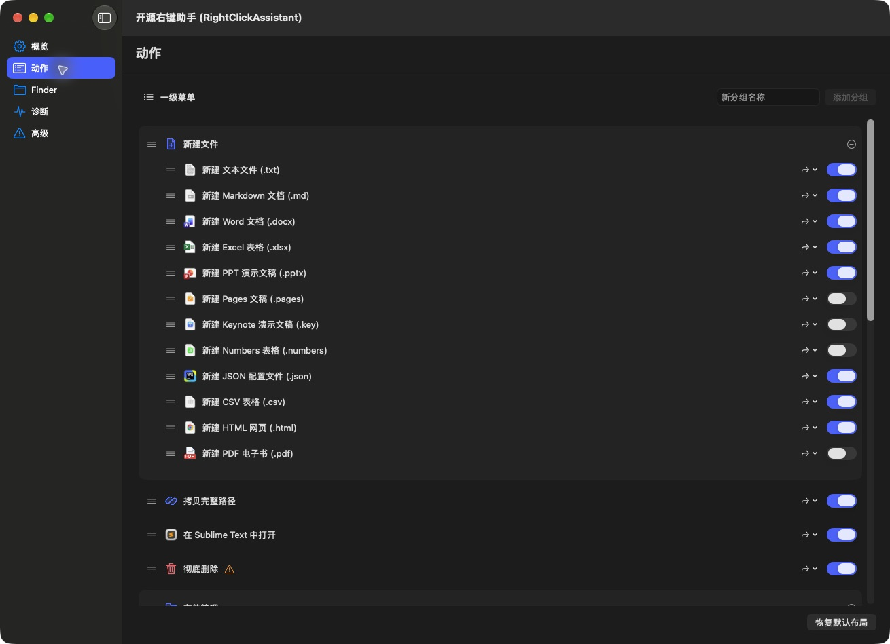
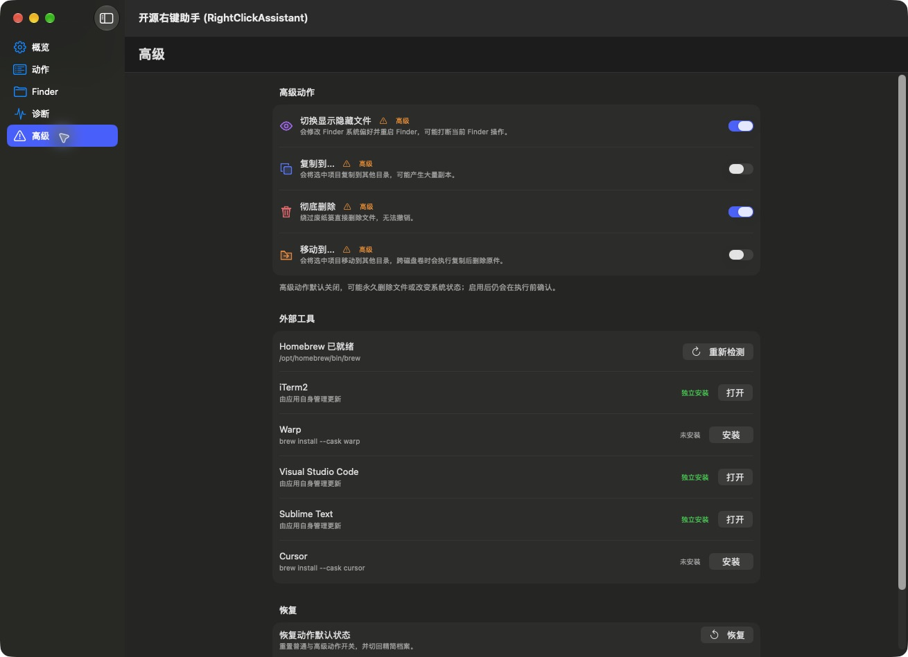

# MacRightClick

[简体中文](README.md) · [Download](https://github.com/quyanchun/MacRightClick/releases/latest)

A macOS Finder context-menu assistant for creating files, copying paths, opening terminals and editors, and everyday file operations. Organize actions into groups, reorder them, and enable only what you need.

> This independently maintained derivative is based on **[guyue55/MacRightClick](https://github.com/guyue55/MacRightClick)**. Thanks to the original author. The original copyright notice and [MIT license](LICENSE) are preserved.

## Current interface

Real screenshots from the current application; the configuration shown is customizable.

| Menu groups and ordering | Advanced actions and external tools |
| :---: | :---: |
|  |  |

## Features

- Create and rename groups, drag to reorder, and move actions between groups and the top-level menu.
- Create text, Markdown, JSON, CSV, HTML, PDF, Office, Pages, Numbers, and Keynote files from templates.
- Cut and paste, copy and move files, copy names and paths, including shell-escaped and Git-relative paths.
- Open selections with installed terminals and editors; directory entry points for Codex and WorkBuddy.
- MD5 / SHA-256, QR codes, PNG / JPEG conversion, Finder scope settings, and diagnostics.

Advanced actions request confirmation before execution. Some actions require the corresponding third-party application.

## Install

Requires **macOS 13+**. Universal 2 packages support **Apple Silicon (arm64)** and **Intel (x86_64)**.

1. Download the DMG or ZIP from this repository's [Releases](https://github.com/quyanchun/MacRightClick/releases), then move `RightClickAssistant.app` to Applications.
2. Open the app, configure Actions, and check the Finder extension.
3. If macOS blocks the first launch, verify the download source and use Control-click → Open, or allow it in System Settings → Privacy & Security.

Version `1.2.1` is an **Ad-hoc signed community build without Apple notarization**. Full Disk Access affects protected file operations; it is not required just to display the menu. Personal settings and action queues are not included in the packages.

## Build from source

Requires Swift 6 and Xcode Command Line Tools:

```sh
git clone https://github.com/quyanchun/MacRightClick.git
cd MacRightClick
SKIP_DMG_LAYOUT=1 bash Scripts/build.sh
```

Outputs: `build/RightClickAssistant.app`, `.dmg`, and `.zip`. The flag skips automatic Finder window layout without changing package contents. Run focused regressions with `bash Scripts/test_regressions.sh`.

## Attribution

- Original project: [guyue55/MacRightClick](https://github.com/guyue55/MacRightClick)
- This repository: [quyanchun/MacRightClick](https://github.com/quyanchun/MacRightClick)
- License: [MIT](LICENSE)
